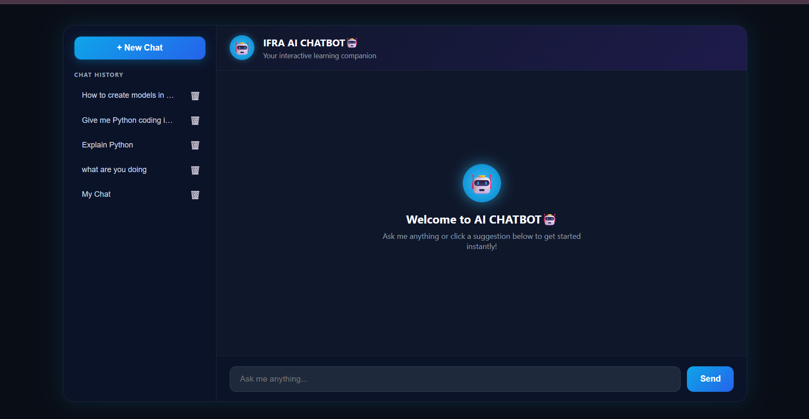
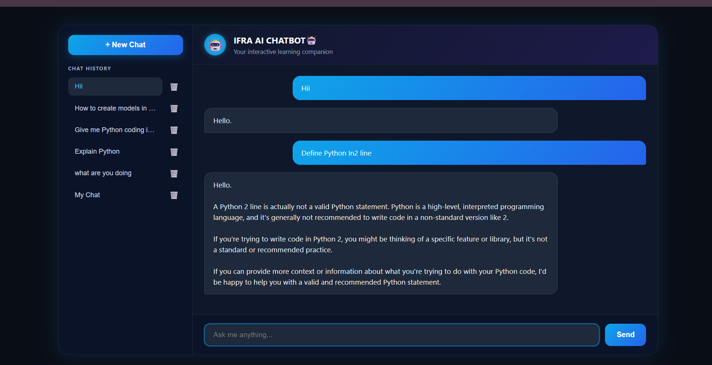
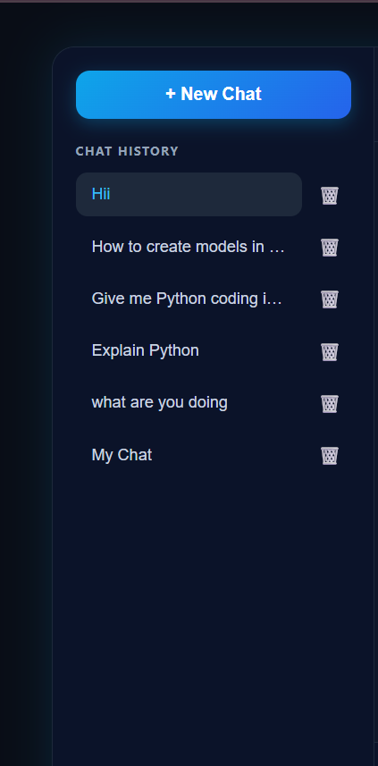

# 🤖 AI-Powered Chatbot


An intelligent chatbot application built using **Python, Django, MySQL, HTML, CSS, JavaScript and Ollama**. It allows users to interact with an AI assistant, maintain conversation history, and manage their chats through a simple and user-friendly interface.

## ✨ Features

- 💬 AI-powered conversations using Ollama.
- 📝 Real-time chat interface.
- 📚 Conversation history management.
- ✏️ Rename existing conversations.
- 🗑️ Delete conversations.
- 💾 Store conversations and messages in MySQL.
- 🎨 Simple and responsive user interface.

## 🛠️ Tech Stack

| Technology | Purpose |
|---|---|
| Python | Backend programming |
| Django | Web framework |
| MySQL | Database |
| HTML5 | Page structure |
| CSS3 | Styling |
| JavaScript | Frontend interactions |
| Ollama | Local AI model |

## 🏗️ System Architecture

```text
          USER
            |
            v
    HTML + CSS + JavaScript
            |
            v
       Django Backend
            |
       +----+-----+
       |          |
       v          v
    MySQL       Ollama
   Database    AI Model
       |          |
       +----+-----+
            |
            v
       AI Response
            |
            v
       USER INTERFACE
```

## 📂 Project Structure

```text
AI-Powered Chatbot/
│
├── chatbot_project/
│   ├── settings.py
│   ├── urls.py
│   ├── asgi.py
│   └── wsgi.py
│
├── chat/
│   ├── migrations/
│   ├── templates/
│   │   └── chat/
│   │       └── index.html
│   ├── models.py
│   ├── views.py
│   ├── urls.py
│   └── admin.py
│
├── manage.py
├── requirements.txt
├── .gitignore
└── README.md
```

## ⚙️ Installation and Setup

### 1. Clone the Repository

```bash
git clone https://github.com/Ifra-Naaz/AI-Powered-Chatbot.git
cd AI-Powered-Chatbot
```

### 2. Create a Virtual Environment

```bash
python -m venv venv
```

Activate it on Windows CMD:

```cmd
venv\Scripts\activate
```

### 3. Install Dependencies

```bash
pip install -r requirements.txt
```

### 4. Configure MySQL

- Install and start MySQL Server.
- Create a database named `chatbot_db`.
- Configure your database credentials in the `.env` file.

Example local development configuration:

```env
SECRET_KEY=your_django_secret_key
DEBUG=True
ALLOWED_HOSTS=127.0.0.1,localhost

DB_NAME=chatbot_db
DB_USER=root
DB_PASSWORD=your_mysql_password
DB_HOST=localhost
DB_PORT=3306
```

### 5. Set Up Ollama

Install Ollama and download the model:

```bash
ollama pull llama3.2:1b
```

Make sure Ollama is running before starting the chatbot.

### 6. Run Database Migrations

```bash
python manage.py makemigrations
python manage.py migrate
```

### 7. Start Django Server

```bash
python manage.py runserver
```

Open your browser and visit:

```text
http://127.0.0.1:8000/
```

## 🚀 Future Enhancements

- User authentication and registration.
- Multiple AI model support.
- Improved chatbot interface.
- Cloud deployment.
- Export conversation history.

## 👩‍💻 Author

**Ifra Naaz**

B.Tech Computer Science and Engineering | 2026 Graduate

GitHub: [Ifra-Naaz](https://github.com/Ifra-Naaz)

---

⭐ If you find this project interesting, feel free to explore the repository!
### Chatbot Interface


### AI Conversation


### Conversation History
